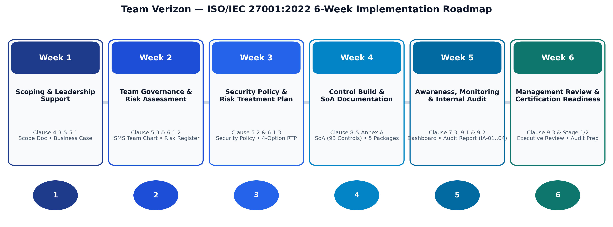
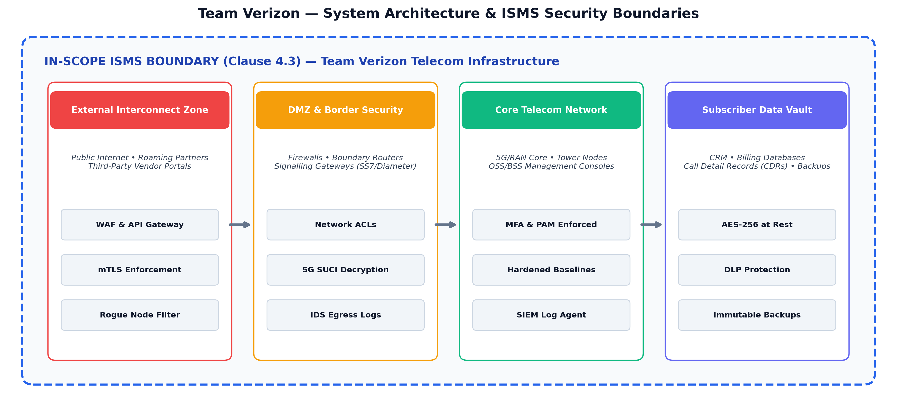
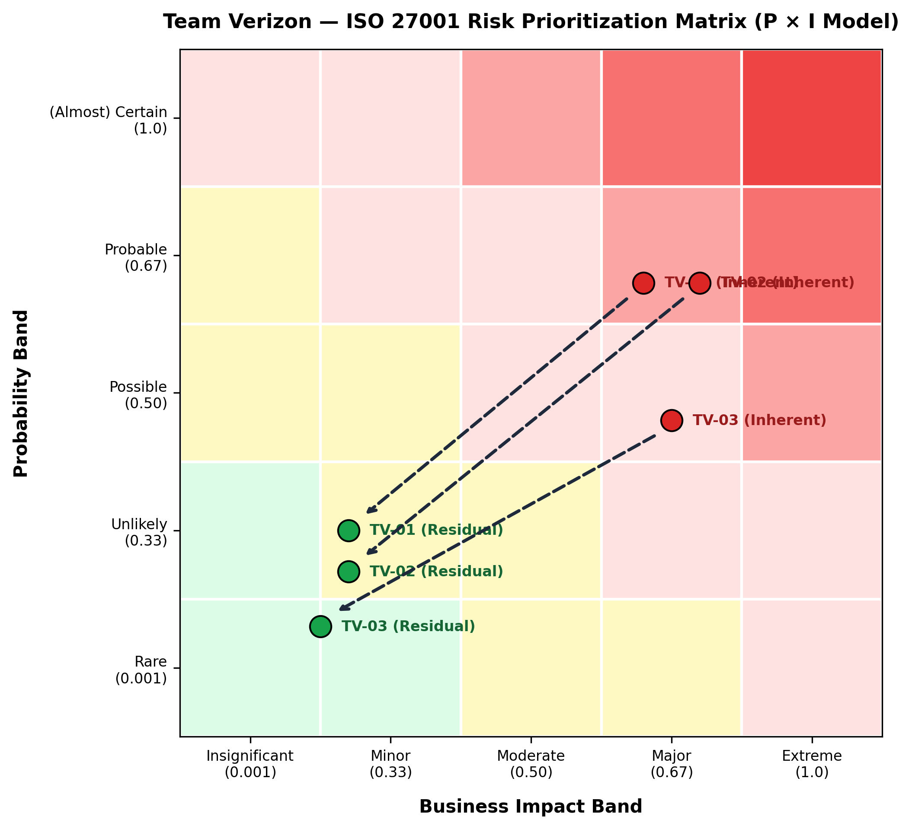

# ISO 27001 ISMS Implementation Project

## 6-Week ISMS Build, Control Rollout & Audit Readiness (Team Verizon / ComNet Case)

## Executive Summary

This repo tells the story of a 6-week ISO/IEC 27001:2022 implementation journey for a telecommunications case study (Team Verizon / ComNet). We started by agreeing what the ISMS would actually cover and getting management behind it, then moved through team setup, risk assessment, policies, control implementation, and finally the checks that prove whether the ISMS is really working.

Week 5 was the reality check: awareness, monitoring, and an internal audit view of the evidence. We didn’t uncover any major nonconformities in this scenario, but we did find a handful of things that needed tightening up—mostly around access reviews, privileged MFA coverage, training/phishing results, and log coverage. Those findings gave us a clear, owned action list to carry into the final reporting and readiness stage.

| Attribute | Detail |
|---|---|
| **Focus Area** | ISO/IEC 27001:2022 ISMS, Risk Assessment & Treatment, Annex A Controls, Audit Readiness |
| **Case Study** | Telecommunications company (Team Verizon / ComNet model) |
| **Key Frameworks** | ISO/IEC 27001:2022 (Clauses 4–10), Annex A:2022, ISO/IEC 27005-informed risk thinking, ISO27k toolkit templates |
| **Core Goal** | Build a scoped, documented ISMS with risk-based controls and evidence ready for review |
| **What we produced** | Scope & mandate, team/roles, risk register & treatment plan, policies/procedures, SoA/control documentation, Week 5 audit findings & actions |

---

## Why this mattered

For a telecom environment, the things that hurt the most are usually the basics done badly: unclear scope, weak access control, poor visibility, and no proof that controls work day to day. The point of this project wasn’t to write policies for the sake of it—it was to connect the dots from *what we need to protect* (customer data, network infrastructure, communications systems) to *how we manage risk* and *how we show evidence*.

---

## How the 6 weeks came together

### Roadmap

| Week | What we focused on | What came out of it |
|---|---|---|
| **1** | ISMS scope & management support | Scope boundaries (customer data, network infrastructure, communication systems), business case, leadership mandate/sponsor |
| **2** | Team formation & risk assessment | ISMS roles/responsibilities, risk assessment approach, scored and prioritized risk register |
| **3** | Policy & risk treatment | Information security policy direction, risk treatment options (mitigate/transfer/accept/avoid), risk treatment plan |
| **4** | Control implementation & documentation | Control packages (encryption, MFA, firewalls, IDS/monitoring, backups), procedures/config baselines, SoA/control documentation |
| **5** | Awareness, monitoring & internal audit | Training/awareness metrics, monitoring dashboard signals, internal audit findings with owners and actions |
| **6** | Management review & certification readiness | Consolidated reporting, readiness view, and handover-ready evidence/story (guided by the Weeks 1–6 guide) |

---

## Scope and context (Week 1)

Week 1 was about drawing the box around the ISMS and getting leadership to back it. The scope centered on the systems and data that matter most in a telecom setting—subscriber/customer data, core and access network components, and the communication services themselves. We also made the case for why this work is worth doing (risk reduction, regulatory/customer trust, and a structured way to run security).

**In plain terms:** define what’s in, what’s out, who owns it, and who’s accountable—otherwise everything that follows gets messy.

---

## Team, risks, and treatment (Weeks 2–3)

In Week 2 we set up the ISMS team (project lead, network/security/compliance perspectives) and built out a risk register. The goal wasn’t to produce a “perfect” scientific model—it was to get a clear, ranked view of what could hurt us most so we could treat the right things first.

Week 3 turned that into decisions: policies that state what Verizon/ComNet expects, and a risk treatment plan that says *how* each risk will be handled (reduce, transfer, accept, or avoid), with owners and target outcomes. That’s where the work starts to feel real, because every control has a reason behind it.

---

## Putting controls in place and writing it down (Week 4)

Week 4 was the build-and-document phase. The focus was on practical control areas that came straight out of the risk treatment plan, including:

- **Encryption** for sensitive customer data (at rest/in transit)
- **Strong authentication / MFA** to reduce credential-based access risk
- **Firewalls and segmentation** to protect core network and management planes
- **Monitoring / detection** to spot suspicious activity and control failures
- **Backups and recovery** (including tested restores) to handle incidents like ransomware

Just as important: documenting what was implemented (procedures, baselines, and control justification/SoA thinking) so there’s something an auditor—or a future team member—can actually follow.

---

## Week 5 check: awareness, monitoring, and internal audit

This was the “are we actually doing what we said?” week. We looked at three things: whether people know what to do, whether controls are behaving as expected, and whether we can prove it.

### What the signals showed
- **Awareness/training:** 92% completion (target 95%) and 98% policy acknowledgement (target 100%) — close, but not quite there.
- **Phishing:** 7% failure rate (target ≤ 5%) — a clear sign we needed more targeted coaching.
- **Privileged training:** 100% — strong result for the higher-risk user group.
- **Monitoring highlights:** backups/restore testing looked good; privileged MFA and SIEM coverage were close (99% and 96%); access reviews (90%) and vulnerability remediation SLA (88%) needed attention.

### Internal audit snapshot
No major nonconformities in the scenario, but the audit surfaced **2 minor nonconformities**, **2 opportunities for improvement**, and **2 positive findings** (backup restore testing and strong control documentation).

| ID | What we found | What we’re doing about it | Owner |
|---|---|---|---|
| **IA-01** | Privileged MFA at 99% | Finish remaining enrollment | IAM / Security Engineering |
| **IA-02** | Access reviews at 90% | Complete overdue reviews | Access Control Owner |
| **IA-03** | Awareness completion 92% and phishing failure 7% (below target) | Targeted coaching and retest | Awareness Lead |
| **IA-04** | Critical log coverage at 96% | Onboard remaining log sources | SOC / Network Operations |

That’s the value of Week 5 in one sentence: it turns “we think it’s fine” into a short list of specific fixes with names next to them.

---

## Risk view

We tracked risks in a structured way (likelihood/impact scoring, treatment decisions, and target outcomes) so the control work stayed tied to real priorities.

If you’re reviewing this project, the key thing to look for is the thread: **scope → risks → treatment → controls → evidence → follow-up actions**.

---

## What I’d take forward (lessons learned)

- **Scope discipline saves time later.** If the boundary is fuzzy, the risk register and evidence get fuzzy too.
- **Controls need owners, not just tools.** MFA, logging, backups—none of it counts if nobody is accountable for gaps.
- **Metrics tell you where to look.** A dashboard doesn’t fix anything by itself, but it points you straight at the weak spots.
- **Audits are useful when they’re specific.** The best output is a small, trackable set of findings with actions and owners.

---

## Project artifacts

All the weekly materials and the guide are included in this repo for context:

| Artifact | Path | Notes |
|---|---|---|
| Week 1 – ISMS Scope & Management Support | [`00_Weekly_Presentations/ISO27001_Week1_ISMS_Scope_and_Management_Support.pptx`](00_Weekly_Presentations/ISO27001_Week1_ISMS_Scope_and_Management_Support.pptx) | Scope, mandate, business case foundation |
| Week 2 – Team Formation & Risk Assessment (v1) | [`00_Weekly_Presentations/TeamVerizon_ISO27001_Week2.pptx`](00_Weekly_Presentations/TeamVerizon_ISO27001_Week2.pptx) | Roles, governance, risk scoring/register |
| Week 2 – Team Formation & Risk Assessment (v2) | [`00_Weekly_Presentations/Week2_TeamVerizon_ISO27001.pptx`](00_Weekly_Presentations/Week2_TeamVerizon_ISO27001.pptx) | Alternate/iterated Week 2 deck |
| Week 3 – Policy & Risk Treatment | [`00_Weekly_Presentations/TeamVerizon_ISO27001_Week3_Policy_and_Risk_Treatment.pptx`](00_Weekly_Presentations/TeamVerizon_ISO27001_Week3_Policy_and_Risk_Treatment.pptx) | Policy direction and treatment planning |
| Week 4 – Control Implementation & Documentation | [`00_Weekly_Presentations/TeamVerizon_ISO27001_Week4_Control_Implementation_and_Documentation.pptx`](00_Weekly_Presentations/TeamVerizon_ISO27001_Week4_Control_Implementation_and_Documentation.pptx) | Controls, procedures, SoA/documentation |
| Week 5 – Awareness, Monitoring & Internal Audit | [`00_Weekly_Presentations/ISO27001_Week5_Verizon_ComNet.pptx`](00_Weekly_Presentations/ISO27001_Week5_Verizon_ComNet.pptx) | Metrics, audit findings (IA-01–IA-04) |
| Weeks 1–6 Beginner Guide | [`00_Weekly_Presentations/Verizon_ISO27001_Beginners_Guide-Weeks1to6.docx`](00_Weekly_Presentations/Verizon_ISO27001_Beginners_Guide-Weeks1to6.docx) | End-to-end walkthrough and context |

> Images used in this README live in [`images/`](images/).

---

## References

- [ISO/IEC 27001:2022 — Information security management systems (Requirements)](https://www.iso.org/standard/27001)
- [ISO/IEC 27002:2022 — Information security controls](https://www.iso.org/standard/75652.html)
- [ISO/IEC 27005 — Guidance on managing information security risks](https://www.iso.org/standard/80585.html)
